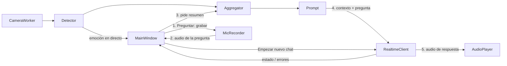

# Emotion Reader + GPT-Live: plan técnico (v2)

## Estado del repositorio
`/workspace` solo contiene un `README.md` y un commit inicial, así que todo se crea desde cero en la rama `cursor/emotion-reader-app-2904`.

## 1. Decisiones confirmadas

### API de voz: Realtime API con `gpt-realtime-2.1`
- Según la documentación oficial (octubre de 2026), `gpt-realtime-2.1` es el modelo Realtime más reciente. Es el valor por defecto de `GPT_LIVE_MODEL` y se puede cambiar sin tocar código.
- Conexión: WebSocket `wss://api.openai.com/v1/realtime?model=...` mediante el SDK oficial `openai[realtime]`.
- Funciona por turnos: `conversation.item.create` (texto o audio), luego `response.create`. El audio llega en `response.output_audio.delta` y el turno termina con `response.done`.
- Audio de entrada y salida: PCM16 mono a 24 kHz (`{"type":"audio/pcm","rate":24000}`), codificado en Base64.
- Se descarta el backend opcional para `gpt-live-1`, así que desaparecen la variable `GPT_LIVE_API` y la interfaz `VoiceBackend`.

### Cómo formula el usuario la pregunta
- Al pulsar "Preguntar", la app empieza a grabar el micrófono (estado "Escuchando"). Al pulsar otra vez, la grabación se detiene y se envía.
- Si el campo de texto opcional tiene contenido, se usa ese texto y no se graba nada.
- En los dos casos se envía primero el contexto emocional como texto y después la pregunta.

### Librerías
- Interfaz: PySide6.
- Cámara: OpenCV.
- Emociones: MediaPipe para detectar la cara y HSEmotion en ONNX (`hsemotion-onnx` + `onnxruntime`) para clasificarla.
- Audio: `sounddevice`.
- API: `openai[realtime]`.
- Configuración: `python-dotenv`.
- Tests y lint: `pytest`, `pytest-qt` y `ruff`.
- Empaquetado: PyInstaller.
- Python de 3.10 a 3.12, con 3.11 recomendado.

### Estructura de carpetas (simplificada)
Hay un archivo por responsabilidad y nada más:
```
main.py                     # punto de entrada: QApplication, permisos, ventana
config.py                   # único lector de variables: Settings (dataclass) desde .env
.env.example                # única fuente de todas las variables (ver sección 2)
emotion_reader/
  camera.py                 # permisos de cámara + CameraWorker (QThread, OpenCV)
  detector.py               # MediaPipe + HSEmotion -> EmotionReading; descarga los modelos si faltan
  aggregator.py             # ventana deslizante de N s -> EmotionSummary (dataclasses incluidas)
  prompt.py                 # EmotionSummary + pregunta -> prompt estructurado
gpt_live_client/
  client.py                 # RealtimeClient: sesión, envío, stream, historial, errores, hilo asyncio
  audio.py                  # MicRecorder + AudioPlayer (PCM16 24 kHz)
ui/
  main_window.py            # vídeo con emoción superpuesta, botones, campo de texto, estados
tests/
  test_emotion_reader.py
  test_gpt_live_client.py
  test_ui.py
packaging/emotion_reader.spec
requirements.txt, requirements-dev.txt, .gitignore, README.md
pyproject.toml              # solo configuración de ruff y pytest
```
Respecto a la v1, he fusionado lo siguiente: `permissions.py` pasa a `camera.py`, `models.py` a `aggregator.py`, `history.py`, `errors.py` y `worker.py` a `client.py`, el micrófono y el reproductor a `audio.py`, y la parte de vídeo y estados a `main_window.py`. El script de descarga de modelos lo sustituye una descarga automática en `detector.py`, y los tests quedan en un archivo por módulo.

### Flujo de datos

Es `MainWindow` quien coordina cada paso. Al pulsar "Preguntar" la primera vez, arranca `MicRecorder`. Al pulsar la segunda vez, recoge el audio grabado y pide el resumen emocional de los últimos N segundos. Después pasa el prompt y la pregunta a `RealtimeClient`, que va reproduciendo la respuesta a medida que llega.

### Ejemplo de prompt (solo texto, nunca imágenes)
```
[Contexto emocional estimado del usuario, últimos 5 s, aproximado]
- Emoción dominante: tristeza (confianza media 0.62, presente en el 70% de los frames)
- Secundarias: neutral (0.21), miedo (0.08)
- Tendencia: empeorando (valencia -0.15 -> -0.40)
- Cara detectada en 48/50 frames
Adapta tono y empatía a este contexto sin mencionarlo salvo que sea útil.
[Pregunta del usuario]: ...
```

## 2. Variables de entorno (único sitio)
Todas las variables están definidas y documentadas en `.env.example`, y el usuario lo copia a `.env`. El único sitio del código que las lee es `config.py`. Ningún otro módulo usa `os.environ`: todos reciben un objeto `Settings`.

```
# --- OpenAI ---
OPENAI_API_KEY=sk-...            # obligatoria; nunca en el código
GPT_LIVE_MODEL=gpt-realtime-2.1  # último modelo Realtime disponible
GPT_LIVE_VOICE=marin             # marin | cedar | alloy | ...
RESPONSE_LANGUAGE=es             # idioma de la respuesta hablada
REQUEST_TIMEOUT_SECONDS=30       # timeout por petición
# --- Emociones / cámara ---
EMOTION_WINDOW_SECONDS=5         # N segundos agregados al pulsar Preguntar
CAMERA_INDEX=0                   # índice de la webcam
```

## 3. Plan de implementación por fases

### Fase (a): entorno, webcam, permisos e interfaz
**a.1. Crear primero el entorno completo**, antes de escribir ninguna funcionalidad:
- Toda la estructura de carpetas del apartado anterior, con `__init__.py` y módulos vacíos o mínimos.
- `requirements.txt`, `requirements-dev.txt`, `.gitignore` (incluye `.env`, `.venv/`, `models/`, `build/`, `dist/`), `.env.example` y un `config.py` funcional.
- Entorno virtual: `python3.11 -m venv .venv && source .venv/bin/activate && pip install -r requirements-dev.txt`.
- Commit independiente: "scaffold project structure and environment".

**a.2. Webcam, permisos e interfaz**:
- `camera.py`: pide el permiso con `QCameraPermission`. Si se deniega, muestra un diálogo con la ruta "Ajustes del Sistema > Privacidad y seguridad > Cámara" y un botón que abre esa pantalla de Ajustes. Con permiso concedido, `CameraWorker` captura frames con OpenCV.
- `main_window.py`: vista en directo, "Preguntar", "Empezar nuevo chat", campo de texto opcional, indicador "Cámara activa", etiqueta de estado y aviso de privacidad.

**Cómo probarla:** comprobar que `pip install -r requirements-dev.txt` termina sin errores y que `python -c "import config; print(config.load_settings())"` muestra la configuración. Después, `python main.py`: debe aparecer el diálogo de permiso, luego el vídeo y el indicador encendido. Para probar la denegación, ejecutar `tccutil reset Camera`, volver a lanzar la app y denegar. Tests: `pytest tests/test_ui.py`.

### Fase (b): detección de emociones y generación del prompt
- `detector.py`: la primera vez descarga los modelos a `models/` y después clasifica en un hilo aparte limitado a unos 10 FPS. Los frames solo se procesan en memoria y no se guardan ni se envían.
- `aggregator.py` calcula la emoción dominante, las secundarias, la confianza y la tendencia a partir de la valencia. `prompt.py` genera el formato del ejemplo. La emoción del momento se superpone al vídeo con un recuadro, una etiqueta y un porcentaje.

**Cómo probarla:** abrir `python main.py` y poner caras distintas; la etiqueta superpuesta debe cambiar. Tests: `pytest tests/test_emotion_reader.py`, con lecturas sintéticas y una imagen de ejemplo.

### Fase (c): integración con GPT-Live (Realtime) y audio
- `client.py`: envía `session.update` con instrucciones en el idioma de `RESPONSE_LANGUAGE`, la voz configurada y PCM a 24 kHz. Después envía el contexto como texto, la pregunta en audio o texto, y `response.create`. Los deltas de audio van al `AudioPlayer` y las transcripciones se guardan en el historial.
- Errores:
  - Clave inválida (401): mensaje claro.
  - Límite de uso (429 o `rate_limit_exceeded`): reintento con backoff.
  - Timeout: controlado con `REQUEST_TIMEOUT_SECONDS`.
  - Sin conexión: reconexión que restaura el historial.
- "Empezar nuevo chat" para el audio, borra el historial y abre una sesión nueva. Los estados de la interfaz son Escuchando, Procesando, Reproduciendo e Inactivo.

**Cómo probarla:** con `OPENAI_API_KEY` en `.env`, ejecutar `python main.py`, pulsar Preguntar, hablar, pulsar otra vez y escuchar la respuesta. Tests: `pytest tests/test_gpt_live_client.py`, con un WebSocket falso y `sounddevice` simulado.

### Fase (d): README y empaquetado
- `README.md`: instalación, permisos de macOS (al ejecutar desde la Terminal, el permiso se concede a la Terminal o a iTerm), configuración de `.env`, uso, solución de problemas, privacidad y aviso de que la detección de emociones es aproximada.
- `packaging/emotion_reader.spec`: genera la `.app` con `NSCameraUsageDescription` y `NSMicrophoneUsageDescription` e incluye los modelos. Se firma ad hoc.
- CI mínima de GitHub Actions con `ruff` y `pytest`.

**Cómo probarla:** ejecutar `pyinstaller packaging/emotion_reader.spec`, abrir `dist/EmotionReader.app` y comprobar que pide los permisos con su propio nombre.

## Limitaciones de verificación en este entorno
Trabajo en una VM Linux sin webcam, sin micrófono y sin macOS. Ahí verificaré con tests automáticos (Qt en modo `offscreen`, cámara sintética y API simulada), con `ruff` y con capturas de la interfaz. La llamada real a OpenAI solo se puede probar si añades `OPENAI_API_KEY` en Cloud Agents > Secrets. Los permisos de macOS y el `.app` tendrás que validarlos en tu Mac.
